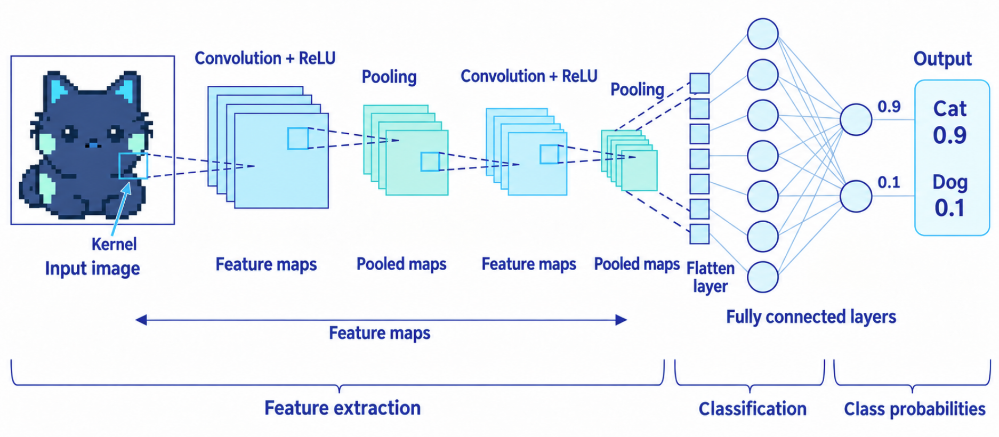
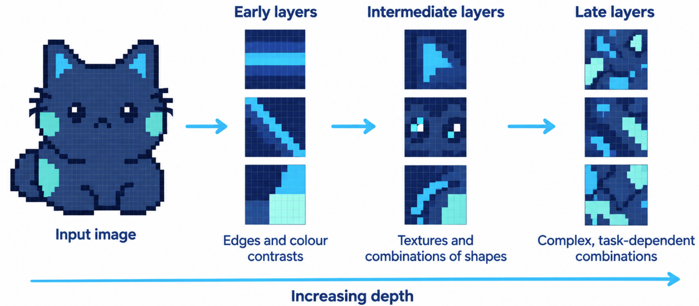

Introduction to Convolutional Neural Networks for Image Analysis
=================================================================

Convolutional Neural Networks (CNNs) are a class of deep learning models widely used for image analysis and computer vision tasks. 
They apply learned filters to extract local patterns from images, producing feature maps that successive layers combine into 
increasingly complex, task-dependent representations.

The following video provides a short introduction to CNNs and their main concepts:

.. youtube:: gDNLHOLGsCg

`Watch this video on YouTube <https://www.youtube.com/watch?v=gDNLHOLGsCg&list=PLI5XvYMIRh6Q&index=4>`__

Images and prediction tasks
--------------------------

Convolutional neural networks (CNNs) learn visual patterns from images. They are widely used for image classification, object detection, 
and segmentation. A digital image is represented by a grid of numerical pixel values. A grayscale image has one channel, whereas an RGB 
image has three channels representing red, green, and blue. A CNN processes these values to learn patterns relevant to its task.

The required output depends on the task:

* **Image classification** assigns a label to an entire image, such as ``cat`` or ``dog``.
* **Object detection** predicts object classes and their locations, typically represented by bounding boxes.
* **Semantic segmentation** assigns a class to each pixel, distinguishing, for example, pixels belonging to a cat from background pixels.

Here, we focus on image classification. A CNN classifier first extracts features from the image and then uses these features to predict 
a class. The feature extraction layers and classifier are usually trained together.

Convolution: extracting local patterns
-------------------------------------

The central operation in a CNN is the **convolution**. A small array of weights, called a **filter** or **kernel**, slides across the 
input. At each position, the input values covered by the filter are multiplied by the corresponding weights. These products are summed, 
and a bias is added to produce one output value. Repeating this operation across the image produces a **feature map**. Each position in 
this map contains the response of the filter to a particular region of the input. The same weights are used at every position, allowing 
the filter to detect the same pattern in different parts of the image.

For example, consider the following image patch and illustrative filter:

.. math::

   X_{\mathrm{patch}} =
   \begin{bmatrix}
   1 & 1 & 1 \\
   0 & 1 & 1 \\
   0 & 0 & 1
   \end{bmatrix},
   \qquad
   K =
   \begin{bmatrix}
   1 & 0 & 1 \\
   0 & 1 & 0 \\
   1 & 0 & 1
   \end{bmatrix}.

With a bias of zero, the output at this position is:

.. math::

   (1\cdot1 + 1\cdot0 + 1\cdot1)
   + (0\cdot0 + 1\cdot1 + 1\cdot0)
   + (0\cdot1 + 0\cdot0 + 1\cdot1) = 4.

Two settings determine how the filter moves across the input:

* **Stride** is the number of pixels by which the filter moves at each step. A stride of one evaluates adjacent positions; a larger stride
  skips positions and generally produces a smaller feature map.
* **Padding** adds values, often zeros, around the input boundary. It allows filters to process boundary regions and can preserve the
  spatial dimensions of the input when combined with a suitable stride.

For example, a 3 x 3 filter applied to a 5 x 5 image with stride one and no padding produces a 3 x 3 feature map.

A convolutional layer usually learns multiple filters, each producing one output feature map. For an input with several channels, each filter 
extends across all input channels, and the weighted products are summed across both spatial positions and channels. The filter weights and 
biases are learned during training rather than specified manually.

ReLU: introducing nonlinearity
-----------------------------

A convolutional layer is commonly followed by a nonlinear activation function. One widely used activation is the **Rectified Linear Unit (ReLU)**:

.. math::

   \operatorname{ReLU}(z) = \max(0, z).

ReLU acts independently on each value: negative values become zero, while positive values remain unchanged. For example, ``[1, 3, 2, -2]`` 
becomes ``[1, 3, 2, 0]``. This nonlinearity allows successive layers to learn relationships that cannot be represented by a sequence of 
linear operations alone. ReLU does not change the dimensions of a feature map.

Pooling: summarizing local regions
---------------------------------

Pooling summarizes small regions of each feature map independently. When used with a stride greater than one, it reduces the spatial
dimensions and the amount of computation required in subsequent layers. Two common operations are:

* **Max pooling**, which retains the largest value in each region.
* **Average pooling**, which computes the mean value in each region.

Consider the following feature map after ReLU:

.. math::

   A =
   \begin{bmatrix}
   1 & 3 & 2 & 0 \\
   4 & 2 & 1 & 5 \\
   0 & 2 & 6 & 4 \\
   1 & 3 & 2 & 0
   \end{bmatrix}.

Using a 2 x 2 pooling window with stride two divides this map into four non-overlapping regions. The results are:

.. math::

   \operatorname{MaxPool}(A) =
   \begin{bmatrix}
   4 & 5 \\
   3 & 6
   \end{bmatrix},
   \qquad
   \operatorname{AvgPool}(A) =
   \begin{bmatrix}
   2.5 & 2 \\
   1.5 & 3
   \end{bmatrix}.

Both operations reduce the 4 x 4 feature map to a 2 x 2 map. Unlike convolutional filters, these pooling operations have no learned weights.

From feature maps to class predictions
-------------------------------------

A CNN classifier typically combines several convolutional layers, nonlinear activations, and operations that reduce spatial resolution. 
The resulting feature maps are converted into a vector that can be used by a classifier. Two common approaches are:

* **Flattening**, which rearranges all feature map values into a single vector. For feature maps of shape height x width x channels, this
  vector contains height x width x channels values.
* **Global average pooling (GAP)**, which averages over all spatial positions within each feature map. The resulting vector contains one
  value per feature map.

   **Overview of a CNN classifier.** Convolutional layers and ReLU
   activations extract features, while pooling summarizes local regions
   and reduces spatial resolution. The resulting feature maps are
   flattened into a vector and passed to fully connected layers to
   produce class scores, which softmax converts into class probabilities.
   Other architectures use global average pooling instead of flattening
   to obtain one value per feature map.

Flattening preserves the individual activation values in the vector, whereas global average pooling summarizes each map. For example,
32 feature maps of size 8 x 8 produce 2,048 values after flattening, or 32 values after global average pooling.

The classifier uses this vector to produce a score, often called a **logit**, for each class. For a classification task with mutually
exclusive classes, a softmax function converts these scores into class probabilities that sum to one. The class with the highest probability
is commonly selected as the predicted label.

Representations across layers
-----------------------------

Successive convolutional layers operate on the feature maps produced by preceding layers. This allows a CNN to combine local patterns into
increasingly complex, task-dependent representations:

* **Early layers** often respond to simple patterns such as edges, orientations, and colour contrasts.
* **Intermediate layers** can combine these patterns into textures and combinations of shapes.
* **Late layers** can represent more complex combinations relevant to the prediction task.

   **Representations across CNN layers.** Early layers often capture
   edges and colour contrasts. Successive layers combine these patterns
   into textures, combinations of shapes, and increasingly complex,
   task-dependent representations. The maps shown are schematic
   illustrations; the representations learned by a CNN depend on its
   architecture, training data, and task.

Deeper activations generally depend on a larger region of the original image, known as their **receptive field**. Their spatial resolution is
often lower because of pooling or strided convolutions.

These descriptions provide an intuition rather than a fixed assignment of meaning to individual filters. The learned representations depend
on the architecture, training data, and task, and a meaningful visual concept may be represented across several feature maps.

References
------------

- **ResNet50 Model:** He, K., Zhang, X., Ren, S., & Sun, J. `Deep residual learning for image recognition. <https://doi.org/10.1109/CVPR.2016.90>`_ CVPR. 2016
- **Tutorial on CNN Feature Visualization:** `Visualizing Filters and Feature Maps in Convolutional Neural Networks using PyTorch <https://debuggercafe.com/visualizing-filters-and-feature-maps-in-convolutional-neural-networks-using-pytorch/>`_
- **XAI Book:** Molnar, C. `Interpretable Machine Learning: A Guide for Making Black Box Models Explainable. <https://christophm.github.io/interpretable-ml-book/>`_ Lulu.com. 2022.
