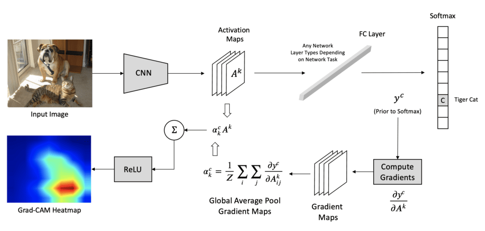

Introduction to Grad-CAM
========================

Grad-CAM (Gradient-weighted Class Activation Mapping) is a **model-specific** explainability method that provides **local explanations** for 
individual predictions of neural networks with convolutional feature maps. For image classification, it produces a class-specific localization 
map that highlights image regions supporting a selected class score.

The following video provides a short introduction to Grad-CAM and its main concepts:

.. youtube:: aMRQlEkiqc0

`Watch this video on YouTube <https://www.youtube.com/watch?v=aMRQlEkiqc0&list=PLI5XvYMIRh6Q&index=9>`__

Attribution methods for images
------------------------------

Attribution methods estimate which parts of an image are relevant to a selected model output. Two common approaches are:

* **Perturbation-based methods** modify or mask image regions and evaluate how the output changes. Examples include occlusion sensitivity, masking-based image SHAP, and image LIME.
* **Gradient-based methods** use derivatives to assess how a selected output responds to changes in the input or intermediate activations. Examples include vanilla gradients, Integrated Gradients, and Grad-CAM.

Grad-CAM uses gradients of a selected class score with respect to convolutional feature-map activations. It summarizes these gradients into 
one weight per feature map and combines the weighted maps into a localization map.

The central idea: combining feature maps
---------------------------------------

As introduced in the CNN section, convolutional layers produce feature maps containing responses to learned patterns at different spatial
positions. A feature map with strong activations does not, by itself, tell us whether those activations support a particular class.

Grad-CAM relates these activations to a selected class score. It assigns each feature map a class-specific weight and computes a
weighted combination:

.. math::

   \sum_k \alpha_k^c A^k,

where :math:`A^k` is feature map :math:`k` and :math:`\alpha_k^c` is its weight for class :math:`c`.

The feature maps describe the activations produced for the image. The gradients determine how these maps are weighted for the selected class.

Grad-CAM for CNNs
----------------

We now describe how to compute a Grad-CAM localization map for a trained CNN classifier. The figure below summarizes the procedure.

   **Overview of Grad-CAM.** A forward pass provides feature maps and
   class scores. Gradients of a selected class score are spatially
   averaged to obtain feature-map weights. The weighted maps are
   summed, passed through ReLU, and resized for visualization.

Step 1: Perform a forward pass
~~~~~~~~~~~~~~~~~~~~~~~~~~~~~

Pass the input image through the CNN to obtain its class scores and retain the feature maps from a selected convolutional layer. We denote
these maps by :math:`A^k`, where :math:`k` identifies one feature map. A convolutional layer typically produces multiple feature maps, one
per filter. Each map contains activations at spatial positions :math:`(i,j)`.

The final convolutional layer is a common choice for Grad-CAM because it combines relatively complex, task-dependent patterns while still
retaining spatial information. Earlier layers can also be selected, but they provide a different level of representation and often a
higher spatial resolution.

Step 2: Select the target class
~~~~~~~~~~~~~~~~~~~~~~~~~~~~~~

Choose the class :math:`c` that you want to explain. This is often the predicted class, but it can also be another class whose explanation
you want to investigate. Let :math:`y^c` denote the score for this class **before softmax**, also called its logit. Using this score avoids 
the additional coupling between class probabilities introduced by softmax.

The explanation is specific to the selected class: the same image can produce different Grad-CAM maps for different target classes.

Step 3: Compute the gradients
~~~~~~~~~~~~~~~~~~~~~~~~~~~~

Compute the gradient of the selected class score :math:`y^c` with respect to each activation in the selected layer:

.. math::

   \frac{\partial y^c}{\partial A_{ij}^k}.

This derivative describes how the class score would change locally if the activation at position :math:`(i,j)` in feature map :math:`k`
changed slightly.

For example:

* A gradient of :math:`+0.5` means that a small increase in the activation would locally increase the selected class score.
* A gradient of :math:`-0.2` means that a small increase in the activation would locally decrease the selected class score.

For a sufficiently small change :math:`\Delta A_{ij}^k`, the score change is approximated by:

.. math::

   \Delta y^c \approx
   \frac{\partial y^c}{\partial A_{ij}^k}
   \Delta A_{ij}^k.

Gradients therefore describe **local sensitivity**, rather than the activation strength itself.

Step 4: Compute the Grad-CAM localization map
~~~~~~~~~~~~~~~~~~~~~~~~~~~~~~~~~~~~~~~~~~~

First, spatially average the gradients within each feature map to obtain one scalar weight:

.. math::

   \alpha_k^c =
   \frac{1}{Z}
   \sum_i \sum_j
   \frac{\partial y^c}{\partial A_{ij}^k},

where :math:`Z = H \times W` is the number of spatial positions in a feature map of height :math:`H` and width :math:`W`.

This operation is **global average pooling of the gradients**. It summarizes the spatial gradients into one class-specific weight per
feature map.

For example, consider the following gradients for a 3 x 3 feature map:

.. math::

   \begin{bmatrix}
   0.0 & 0.2 & -0.1 \\
   -0.2 & 0.5 & 0.1 \\
   0.1 & 0.0 & 0.3
   \end{bmatrix}.

Their sum is :math:`0.9`. Averaging over the nine positions gives:

.. math::

   \alpha_1^c = \frac{0.9}{9} = 0.1.

Repeat this calculation for every feature map in the selected layer. The resulting weights depend on the input image and target class;
they are computed for the explanation rather than learned as fixed model parameters.

Next, multiply each feature map by its weight, sum across all maps, and apply ReLU:

.. math::

   L_{\mathrm{Grad\text{-}CAM}}^c =
   \operatorname{ReLU}
   \left(
      \sum_k \alpha_k^c A^k
   \right).

ReLU sets negative values in the weighted sum to zero and retains positive values. Grad-CAM uses this positive part of the weighted
combination to highlight regions supporting the selected class.

Step 5: Resize and visualize the map
~~~~~~~~~~~~~~~~~~~~~~~~~~~~~~~~~~~

The Grad-CAM map has the spatial dimensions of the selected feature maps, which are often smaller than the input image. Resize the map
to the input image dimensions using interpolation, then display it as a heatmap overlaid on the original image.

Interpreting the explanation
----------------------------

Higher map values indicate stronger positive support according to Grad-CAM. They are not class probabilities or precise measurements
of individual pixel contributions. Because the original localization map is often coarse, Grad-CAM highlights regions rather than 
precise object boundaries. Resizing makes the map easier to compare with the input but does not add spatial detail.

When examining the heatmap, consider whether the highlighted regions correspond to features relevant to the task or to contextual patterns,
such as the background. Grad-CAM helps investigate model behaviour, but a plausible-looking heatmap alone does not establish that the
model has learned the intended reasoning.

References
----------

* **Original paper:** Selvaraju, R. R., Cogswell, M., Das, A., Vedantam, R., Parikh, D., and Batra, D. `Grad-CAM: Visual Explanations from Deep Networks via Gradient-based Localization. <https://doi.org/10.1109/ICCV.2017.74>`_ ICCV, 2017.
* **Tutorial:** `Grad-CAM for ResNet152 network <https://medium.com/@stepanulyanin/grad-cam-for-resnet152-network-784a1d65f3>`_.
* **XAI book:** Molnar, C. `Interpretable Machine Learning: A Guide for Making Black Box Models Explainable. <https://christophm.github.io/interpretable-ml-book/>`_ 2022.

