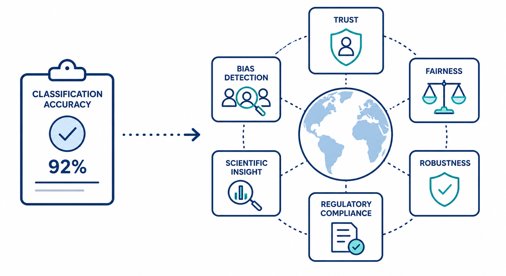

Why is explainability important?
=================================

Machine learning models are typically evaluated using performance metrics such as accuracy, precision, or recall. 
While these metrics provide a useful summary of predictive performance, they rarely capture all aspects that matter 
in real-world applications. Explainable AI complements these metrics by helping us understand *why* a model makes 
its predictions and whether those predictions can be trusted.

To Mitigate Ethical Issues
----------------------------

Real-world data is messy! Databases created from real-world data are incomplete, skewed, and subject to sampling errors. 
Additionally, data is often collected for a particular purpose; when such databases are made publicly available, they 
often only limitedly fit the use case of a new ML model. Such, and other, issues influence how well a machine learning system works. 

Even though machine learning models’ performances are usually output as one – or few – metrics, a single model likely works 
unequally well for different people. That is because people are different, and their individual characteristics map the 
statistical model unequally well. Even subtle differences in performance for different people or population groups can 
lead to issues, such as biases or fairness issues, and users need to be aware of the limitations of the systems they use. 
Such issues have been found in several high-profile instances of image recognition, where systems failed to work accurately 
for users from ethnic minority groups.

Another well-known example would be machine learning-aided job recruitment: when socially biased data is used to train machine 
learning models that are built to predict who should or should not be recruited, the resulting models can reinforce these 
social biases and, for example, favor males over females in the recruitment process. To prevent machine learning models 
from perpetuating or even reinforcing adverse effects, actions must be taken. 

For Science
-------------

The goal of scientific discovery is to understand. Data collection and analysis is a core element of scientific methods, 
and scientists have long used statistical techniques to aid their work. As early as the 1900s the development of the 
t-test gave researchers a new tool to extract insights from data to test the veracity of their hypotheses. Today, machine 
learning has become a vital tool for researchers across domains to analyze large datasets, detect previously unforeseen 
patterns, or extract unexpected insights. 

For example, machine learning is used in areas like computational biology to analyze genomic data or to predict the 
three-dimensional structures of proteins, in computational climate science to understand the effects of climate change 
on cities and regions (e.g. by combining local observational data to large-scale climate models, researchers hope to 
acquire more detailed pictures of the local impacts of climate change), or in computational physics to find patterns 
in vast amounts of astronomical data that can be very noisy.

In some contexts, the accuracy of these methods alone is sufficient to make AI useful – filtering telescope observations 
to identify likely targets for further study, for example. However, researchers want to know not just what the answer 
is but why! Explainable AI can help researchers to understand the insights that come from research data, by providing 
accessible explanations of which features have been particularly relevant in the creation of the system’s output. 
A project that is working on explainable AI for science is, for example, the Automated Statistician project. They have 
created a system that can generate an explanation of its forecasts or predictions, by breaking complicated datasets 
into interpretable sections and explaining its findings in accessible language. Together, the machine learning system 
and the explanations help researchers analyze large amounts of data and enhance their understanding of the features 
of that data (*The Royal Society, 2019*).

For Technology Acceptance
----------------------------

It is a long way from research to application! Having machine learning tools at hand - even ones that work very well - does 
not necessarily mean they will be used in practice. Let’s look at medicine as an example: Medical imaging is an essential 
tool for physicians in diagnosing a range of diseases – and there are a lot of excellent machine learning tools available 
that can assist physicians in interpreting medical images such as X-rays, retina scans, or ultrasounds. But, in practice, 
high performance scores are not enough to ensure a successful implementation of machine learning algorithms in clinical 
practice. A core element for doctors to use any technology in their work is trust and in order to trust, they need to be 
able to understand why an AI has made a specific prediction. This understanding is crucial for doctors to identify edge 
cases in which they should reject a model’s prediction. The identification of such a situation, however, might have 
life-altering effects for the affected patient.

A recent research project by DeepMind and Moorfields Eye Hospital points to new methods that can allow doctors to better 
understand AI systems in the context of medical imaging. This project looked at over 14,000 retinal scans, creating an 
AI system that analyzed these images to detect retinal disease. On top of using deep learning techniques that would 
usually be considered “black box”, researchers built explainability mechanisms, so that human users were able to 
understand why the model had made a recommendation about the presence or absence of disease. 

This explainability was built into the system, making it decomposable. The system itself consists of two neural networks, 
each performing different functions. The first analyzes a scan, using deep learning to detect features in the image that 
illustrate the presence (or absence) of disease – hemorrhages in the tissue, for example. This creates a map of the 
features in the image. The second analyses this map, using the features identified by the first to present clinicians 
with a diagnosis, while also presenting a percentage to illustrate confidence in the analysis.

At the interface of these two systems, clinicians can access an intermediate representation that illustrates which areas 
of an image might suggest the presence of eye disease. This can be integrated into clinical workflows and interrogated 
by human experts wishing to understand the patterns in a scan and why a recommendation has been made, before confirming 
which treatment process is suitable. Clinicians, therefore, remain in the loop of making a diagnosis and can work with 
patients to confirm treatment pathways (*The Royal Society, 2019*).

To Meet Regulatory Requirements
--------------------------------------
In 2018 the General Data Protection Regulation (GDPR) was enacted. 

Article 15 states:

  | §1 	The data subject shall have the right to obtain from the controller confirmation as to whether or not personal data concerning him or her are being processed, and, where that is the case, access to the personal data and the following information:  
  | […]
  | (h) the existence of automated decision-making, including profiling, referred to in Article 22(1) and (4) and, at least in those cases, meaningful information about the logic involved, as well as the significance and the envisaged consequences of such processing for the data subject.

The European Union adopted this idea in the AI Act (2024); the European Parliament advocated to “boost citizens’ 
right to file complaints about AI systems and receive explanations of decisions based on high-risk AI systems that significantly 
impact their rights” (*European Parliament, 2023*).

These legal texts mean that citizens should be encouraged to and have a legal right to ask for – and receive – information 
about how their data is being processed by ML (among other information, such as how it is being collected, stored, deleted, 
and so on). Consequently, it is the duty of those who use the data to be able to give such information upon request. 
XAI methods, thus, can not only help retrieve information about how a black-box algorithm operates but also help fulfill this legal duty.

To Support Robustness Analysis
--------------------------------------
Adversarial attacks deliberately modify inputs to mislead a machine learning model. For example, an image may still look like a cat to a human, while subtle changes cause the model to classify it as a dog. Attacks differ in the information available to the attacker, the modifications permitted, and their objective. In white-box settings, attackers have access to the model’s parameters and architecture; in black-box settings, their access is more limited.

XAI methods can support the investigation of these attacks. For image classifiers, explanation maps aim to highlight regions that contribute to a prediction. Comparing maps before and after an attack may reveal changes that warrant further investigation. Klawikowska et al. (2020), for example, use XAI methods to inspect the effects of adversarial attacks and defense strategies.

However, an unusual heatmap does not establish that an attack occurred, and a plausible heatmap does not establish that a prediction is trustworthy. Some explanation methods produce convincing maps that are insensitive to what the model has learned, as discussed in `Sanity Checks for Saliency Maps <https://xai-tutorials.readthedocs.io/en/latest/_xai_limitations/sanity_checks_saliency.html>`_ . Explanations can also be targeted by adversarial manipulation, so passing these sanity checks does not establish resistance to attacks.

One approach to improving model robustness is **adversarial training**: generating adversarial examples and including them during training. This is a separate intervention from XAI. Explanation methods can help inspect its effects, but producing explanations does not itself protect the model.

XAI therefore serves as a complementary diagnostic tool for investigating vulnerabilities and evaluating countermeasures. Any detection or defense system that uses explanations must be evaluated against attacks designed to evade it.

References
-----------
European Parliament. `AI Act: A step closer to the first rules on Artificial Intelligence <https://www.europarl.europa.eu/news/en/press-room/20230505IPR84904/ai-act-a-step-closer-to-the-first-rules-on-artificial-intelligence?xtor=AD-78-%5bSocial_share_buttons%5d-%5bwhatsapp%5d-%5ben%5d-%5bnews%5d-%5bpressroom%5d-%5bai-act-committee-vote%5d&>`_, Press Release. 2023.

Klawikowska et al. `Explainable AI for Inspecting Adversarial Attacks on Deep Neural Networks <https://doi.org/10.1007/978-3-030-61401-0_14>`_. Artificial Intelligence and Soft Computing: 19th International Conference. 2020.

Miller. `Explanation in artificial intelligence: Insights from the social sciences. <https://arxiv.org/abs/1706.07269>`_ Artificial Intelligence. 2019.

Molnar. `Interpretable Machine Learning: A Guide for Making Black Box Models Explainable. <https://christophm.github.io/interpretable-ml-book/>`_ Lulu.com. 2022.

The Royal Society. `Explainable AI: The basics. <https://royalsociety.org/-/media/policy/projects/explainable-ai/AI-and-interpretability-policy-briefing.pdf>`_ Policy Briefing. 2019. 
